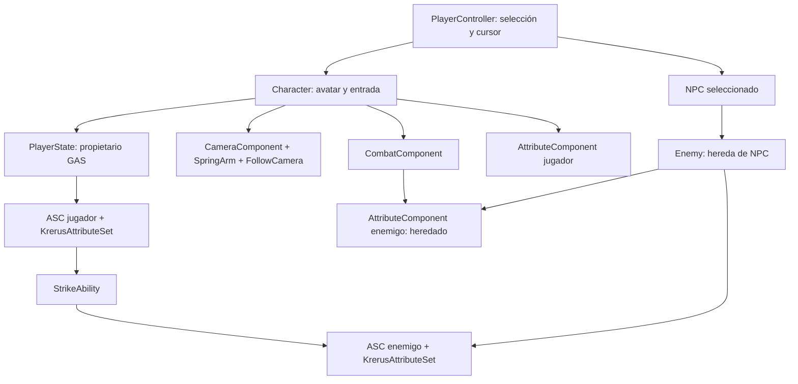

# Arquitectura del código de Krerus

Mapa del estado actual de `Source/Krerus`, revisado el 27 de octubre de 2026 para Unreal Engine 5.8. Describe el código C++ existente; los valores y comportamientos configurados en Blueprints y Gameplay Effects pueden complementar estos flujos. Esta revisión solo cambia formato y comentarios, sin migrar sistemas ni alterar el comportamiento.

## Mapa de clases y responsabilidades

| Clase o grupo | Responsabilidad actual | Dependencias y propiedad |
| --- | --- | --- |
| `AKrerusCharacter` | Avatar del jugador: entrada, movimiento, cámara, puente de animación del autoataque y solicitud de Strike. | Posee `CameraBoom`, `FollowCamera`, `CameraSystem`, `AttributeComponent` y `CombatComponent`. Obtiene el ASC de `AKrerusPlayerState`. |
| `AKrerusPlayerState` | Aloja el ASC y `UKrerusAttributeSet` del jugador; concede `StartupAbilityClass` en `BeginPlay` con autoridad. | ASC replicado en modo `Mixed`; el Character se registra como Avatar, con PlayerState como Owner. |
| `AKrerusPlayerController` | Cursor, selección de NPC, distinción entre clic y arrastre, activación/desactivación del autoataque. | Conserva `SelectedNPC` mediante referencia débil. Cambiar la selección limpia el objetivo del combate anterior y actualiza el anillo de selección. |
| `UKrerusCombatComponent` | Cadencia, pausa y validación del autoataque; aplicación de su impacto. | Pertenece al Character. Usa `AKrerusEnemy` y los atributos tradicionales de ambos actores; escucha `OnDeath`. |
| `UKrerusAttributeComponent` | Vida, recurso, atributos primarios, derivados y modificadores del sistema tradicional. | Pertenece al Character y al NPC. Sus delegados notifican salud, muerte, recursos y estadísticas. No escribe en GAS. |
| `UKrerusAttributeSet` | Vida y maná de GAS con replicación y limitación tras ejecutar efectos. | Subobjeto del PlayerState y del enemigo. Se declara en `Private/KrerusAttributeSet.h`; `Public/UKrerusAttributeSet.h` es una cabecera de marcador sin clase. |
| `UKrerusStrikeAbility` | Habilidad GAS `InstancedPerActor`, ejecutada en servidor (`ServerOnly`). | Consulta la selección del PlayerController y aplica `DamageEffectClass` al ASC del enemigo. |
| `AKrerusNPC` | Base de personajes seleccionables e interactuables. | Hereda de `ACharacter` e implementa `IKrerusInteractable`. Crea el AttributeComponent tradicional; Blueprint implementa `SetSelectionRingVisible`. |
| `AKrerusEnemy` | NPC atacable: reacciones, muerte y permanencia del cadáver. | Hereda de NPC y añade ASC propio en modo `Full`, replicado, y `GASAttributeSet`. Reacciones y muerte siguen ligadas al AttributeComponent heredado. |
| `UKrerusCameraComponent` | Distancia deseada de zoom, interpolación del SpringArm y límites verticales. | El Character lo inicializa y actualiza; recibe el SpringArm y el PlayerController, sin gestionar objetivos ni daño. |
| `UKrerusInteractable` / `IKrerusInteractable` | Contrato de interacción disponible en C++ y Blueprint. | El Character despacha `Execute_Interact` sobre el NPC seleccionado después de comprobar distancia horizontal. |
| `FKrerusPrimaryAttributes`, `FKrerusAttributeModifier`, `FKrerusDerivedAttributes`, `FKrerusAttributeScaling` | Datos y coeficientes del cálculo tradicional de estadísticas. | AttributeComponent suma modificadores con GUID, calcula atributos finales, derivados y vida máxima. El autoataque usa `AttackPower`. |
| `EKrerusResourceType`, `FKrerusResource` | Recurso tradicional: None, Mana, Energy o Rage. | AttributeComponent lo inicializa, consume y restaura. Es independiente del atributo GAS `Mana`. |
| `Krerus.cpp` / `Krerus.h` | Registro del módulo principal. | `IMPLEMENT_PRIMARY_GAME_MODULE` utiliza `FDefaultGameModuleImpl`. |

Las flechas representan relaciones de uso o propiedad según la tabla; no implican replicación ni sincronización de atributos.

## Distribución de Character y ciclo de GAS

La clase Character se implementa en tres archivos para repartir responsabilidades:

- `KrerusCharacter.cpp`: subobjetos, inicialización, Tick, montaje e impacto del autoataque y vínculo con GAS.
- `KrerusCharacterInput.cpp`: Enhanced Input, contexto local, cursor, interacción y peticiones de combate.
- `KrerusCharacterMovement.cpp`: movimiento relativo a la cámara o a la orientación inicial, sprint y desaceleración.

`PossessedBy` y `OnRep_PlayerState` llaman a `InitializeAbilitySystem`. Esta función obtiene el ASC del PlayerState y ejecuta `InitAbilityActorInfo(KrerusPS, this)`: Owner = PlayerState, Avatar = Character. `GetAbilitySystemComponent` del Character delega en PlayerState; no crea otro ASC para el jugador.

`AKrerusPlayerState::BeginPlay` concede la clase inicial solamente cuando hay autoridad, clase configurada y ASC. La concesión y el enlace del Avatar son pasos distintos. El enemigo inicializa su ASC con `InitAbilityActorInfo(this, this)` en su propio `BeginPlay`.

## Targeting, cámara e interacción

El clic izquierdo comienza guardando su posición en pantalla. `Look` registra el desplazamiento cuando está activa la cámara libre. Al soltar, el controlador selecciona únicamente si el movimiento acumulado no alcanzó el umbral de arrastre. La selección usa una traza `ECC_Visibility` desde la posición inicial y acepta actores `AKrerusNPC`.

`SetSelectedNPC` limpia el objetivo del CombatComponent antes de sustituir la selección, oculta el anillo anterior y muestra el nuevo mediante el evento Blueprint del NPC. Seleccionar por sí solo no inicia un autoataque. Strike consulta esta misma selección, mientras que CombatComponent almacena su propio `CombatTarget` cuando se activa el autoataque.

El Character mantiene los modos de cámara y deriva la captura del cursor al controlador. CameraComponent conserva el zoom deseado; el Tick del Character interpola la distancia del SpringArm. El movimiento usa la rotación del controlador con control de cámara activo; en el otro modo conserva la orientación del personaje al iniciar el movimiento.

Para interactuar, el Character obtiene el NPC seleccionado, comprueba `GetInteractionDistance` con distancia 2D y ejecuta la interfaz `IKrerusInteractable`. La implementación C++ base del NPC registra la interacción; los detalles adicionales pueden depender de Blueprint.

## Flujo del autoataque tradicional

1. Enhanced Input llama a `AKrerusCharacter::OnAutoAttack`, que delega en `AKrerusPlayerController::ToggleAutoAttack`.
2. Si ya hay autoataque, el controlador lo detiene. En otro caso convierte el NPC seleccionado a `AKrerusEnemy`, lo asigna al CombatComponent y llama a `StartAutoAttack`.
3. `StartAutoAttack` valida objetivo y vida tradicional de jugador y enemigo, descarta cadáveres, se suscribe a la muerte del objetivo y activa un temporizador repetitivo con `GetAttackInterval`. La cadencia está limitada inferiormente a `0.1f`.
4. Cada `PerformAutoAttack` comprueba pausa, actores, vida, alcance horizontal (`Dist2D <= AttackRange`), arco frontal (producto escalar 2D `>= 0.0f`) y ausencia de un montaje de autoataque activo. Si procede, habilita un impacto pendiente y pide al Character reproducir el montaje. Este paso no aplica daño.
5. `PlayAutoAttackMontage` calcula la velocidad usando la duración del montaje y `max(1.0f, AttackInterval) * 0.9f`, y registra el delegado de finalización. Los assets de animación deben llamar a `OnAutoAttackImpact` en el momento del golpe; esta revisión no modifica esos assets.
6. `OnAutoAttackImpact` delega en `ApplyAutoAttackImpact`. Este exige un montaje activo, consume el impacto una sola vez y vuelve a comprobar estado de ataque, actores, vida, distancia y orientación.
7. El daño mantiene la fórmula `BaseAttackDamage + DerivedAttributes.AttackPower * AttackPowerCoefficient`. Se aplica mediante `TargetAttributes->ApplyDamage(Damage)` sobre **UKrerusAttributeComponent**, y después se emite `OnAutoAttackHit`.
8. `ApplyDamage` limita la vida tradicional, emite `OnHealthChanged` y, al agotarse, `OnDeath`. El enemigo escucha estos eventos para reacción al golpe y muerte; combate escucha la muerte de jugador y objetivo para detenerse.

Interrumpir el montaje cancela su impacto pendiente. Detener el autoataque limpia el temporizador y la suscripción al objetivo e invalida el impacto. Al salir del componente también se elimina la suscripción a la muerte del jugador. Reanudar desde pausa intenta un ataque inmediato y reprograma el temporizador si el combate continúa activo.

La muerte tradicional del enemigo intenta reproducir `DeathMontage`, cambia la respuesta de la cápsula frente a Pawn y programa `CorpseDuration`. Las validaciones de montaje, mesh y AnimInstance pueden cortar esta función antes de esos pasos. Al vencer el tiempo, limpia la selección del PlayerController de índice 0 si apunta a este actor, lo oculta y desactiva sus colisiones; no lo destruye.

## Flujo de la habilidad GAS Strike

1. `StrikeAction` llama a `AKrerusCharacter::ActivateStrike`.
2. El Character obtiene el ASC del PlayerState, recorre las habilidades concedidas y solicita `TryActivateAbility(Spec.Handle)` para la primera que derive de `UKrerusStrikeAbility`.
3. GAS ejecuta `UKrerusStrikeAbility::ActivateAbility` según la política existente `ServerOnly`. Se validan ActorInfo, Avatar y `DamageEffectClass`, Character, PlayerController, enemigo seleccionado y ASC del enemigo.
4. Se comprueba alcance con **distancia 3D** (`FVector::Dist`) y `AbilityRange`, a diferencia del alcance 2D del autoataque. No se añade una comprobación de arco frontal o de vida tradicional en este flujo.
5. `CommitAbility` confirma coste y enfriamiento configurados en la habilidad. Si falla, la habilidad termina cancelada. Los valores concretos pertenecen a la configuración de habilidades/efectos y no se deducen de la fórmula del autoataque.
6. Se crea un spec de `DamageEffectClass` a nivel `1.0f`. Si es válido, el código aplica `ApplyGameplayEffectSpecToSelf` sobre el **ASC enemigo**. El efecto configurado determina la modificación de atributos.
7. `UKrerusAttributeSet::PostGameplayEffectExecute` limita Health y Mana a sus máximos cuando cambia el atributo correspondiente. Las funciones `OnRep_*` usan las notificaciones de GAS y los cuatro atributos conservan `COND_None` y `REPNOTIFY_Always`.
8. Se registran vida GAS del enemigo y maná GAS del jugador cuando ambos sets están disponibles, y se llama a `EndAbility`. No se llama a `UKrerusAttributeComponent::ApplyDamage` ni a sus delegados de muerte desde esta habilidad.

La selección del controlador se consulta en el contexto donde corre la habilidad. Este documento describe el código observado; no acredita sincronización del targeting entre cliente y servidor ni pruebas multijugador.

## Actualmente conviven dos sistemas de vida

| Circuito | Almacenamiento | Consumidores actuales |
| --- | --- | --- |
| Tradicional | `UKrerusAttributeComponent::CurrentHealth` / `MaxHealth` | Autoataque, validaciones de vida tradicionales, reacción del enemigo, muerte y `IsCorpse`. |
| GAS | `UKrerusAttributeSet::Health` / `MaxHealth` | Gameplay Effects, habilidad Strike y sus registros de resultado. |

**Los dos valores son independientes y no están sincronizados por este código.** Agotar la vida GAS con Strike no agota la vida tradicional que consulta el autoataque; tampoco dispara automáticamente la muerte tradicional del enemigo. Un enemigo puede aparecer sin vida GAS y seguir teniendo vida para los ataques básicos. El maná/recurso tradicional y el maná GAS también son independientes.

No se ha añadido sincronización, sustituido el daño ni migrado la muerte a GAS en esta revisión. Esa convivencia se conserva expresamente.

## Laboratorio GAS separado

| Clase | Función y diferencias con el circuito jugable |
| --- | --- |
| `AKrerusGASLabCharacter` | Posee ASC y `UKrerusGASLabAttributeSet` en el propio personaje, inicializa Owner y Avatar a sí mismo, concede `StartupAbilityClass` con autoridad y enlaza la tecla `One` a la prueba. |
| `AKrerusGASLabTarget` | Actor con SceneRoot, ASC y atributos del laboratorio; se inicializa como Owner y Avatar de su ASC. |
| `UKrerusGASLabStrike` | Comprueba autoridad y confirma la habilidad; localiza un objetivo con `GetActorOfClass`, aplica el efecto y registra vida/maná. No emplea PlayerController ni la selección del juego. |
| `UKrerusGASLabAttributeSet` | Vida y maná replicados del laboratorio, separados de `UKrerusAttributeSet` del circuito jugable. |

Las lecturas finales de `UKrerusGASLabStrike` presuponen un objetivo y ASC disponibles, aunque la aplicación previa del efecto tenga una comprobación. Se documenta esta dependencia existente sin cambiar las validaciones ni corregir lógica.

## Alcance de la revisión

Formato a cuatro espacios y llaves Allman en los `.h/.cpp`, comentarios de responsabilidades y conexiones, sin reordenar includes, cambiar identificadores, firmas, fórmulas, metadatos de Unreal ni replicación. Se conservan las dependencias y la arquitectura existentes, incluido el marcador `Public/UKrerusAttributeSet.h`.

La validación específica de esta revisión se entrega junto al diff y al registro de compilación; la lectura de estos flujos no sustituye una prueba en juego ni de red.
