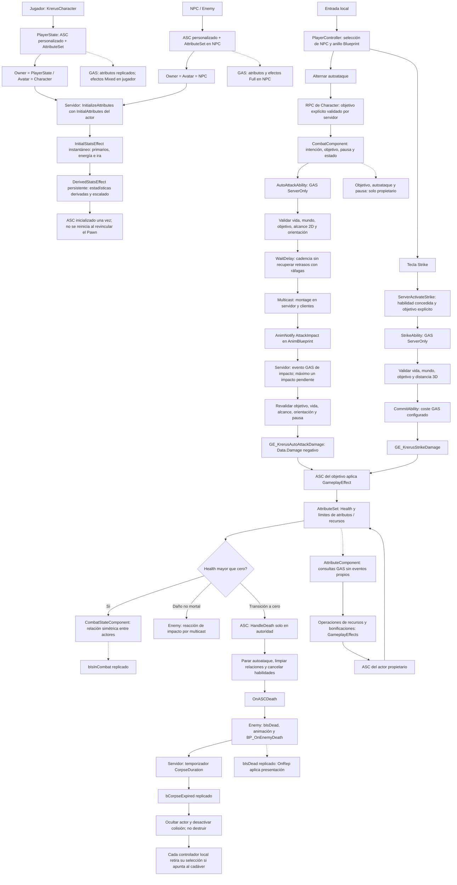

# Krerus: flujo real de combate

Revisión: 29 de octubre de 2026, Unreal Engine 5.8.4. Describe el código aplicado en `Source/Krerus`, no una arquitectura propuesta.

## Responsabilidades

| Elemento | Responsabilidad |
| --- | --- |
| ASC personalizado | Inicialización autoritativa única y transición común de muerte. Usa Avatar, no el PlayerState, para buscar componentes de combate. |
| AttributeSet | Almacén GAS único, límites y notificaciones de replicación de los 16 atributos. |
| GameplayEffects | Inicialización, derivados, bonificaciones, variaciones de recursos, daño y coste. |
| AutoAttackAbility | Esperas GAS, impacto único, cancelación y cadencia. Conserva el límite temporal entre activaciones. |
| StrikeAbility | Validación y ejecución autoritativa de Strike y su coste. El asset existente se llama GE_KrerusStrike aunque sea una habilidad. |
| CombatComponent | Configuración e intención del autoataque; no aplica daño por su cuenta. |
| CombatStateComponent | Relaciones simétricas, estado de combate y limpieza también en EndPlay. |
| Enemy | Reacción visual, estado persistente de muerte, animación y duración/retirada del cadáver. |
| AttributeComponent | Consultas y operaciones Blueprint sobre GAS; sin eventos, suscripciones, inicialización ni lógica de muerte. |
| PlayerController | Selección local y anillo; el servidor recibe el objetivo explícito para cada acción. |

## Interrupciones y red

Parar, pausar, cambiar de objetivo, interrumpir el montage o morir invalida el impacto pendiente. La habilidad observa también Health del objetivo para detenerse cuando este muere. Los notifies del cliente no aplican daño. Salir de alcance u orientación bloquea el impacto; volver a una posición válida permite continuar.

El servidor concede autoataque y la habilidad inicial en PlayerState. Character vincula el ASC desde PossessedBy y OnRep_PlayerState. NPC configura su propio Owner/Avatar; Enemy reutiliza ese vínculo. La vida GAS decide la muerte; bIsDead replica su presentación y cubre el orden de llegada de los paquetes. La notificación nativa OnASCDeath no es un RPC.

Se retiraron los eventos de vida/recurso del componente y sus consumidores de debug. Una futura interfaz debe consultar el valor inicial y escuchar directamente los delegados GAS de los atributos que necesita. El código actual no crea otra capa de notificación. FKrerusResource solo selecciona Type; valores y máximos proceden del AttributeSet y la configuración de InitialAttributes.

No se ha añadido IA ofensiva para NPC, regeneración, resurrección, recompensas ni destrucción del cadáver: el flujo refleja las funcionalidades existentes.
